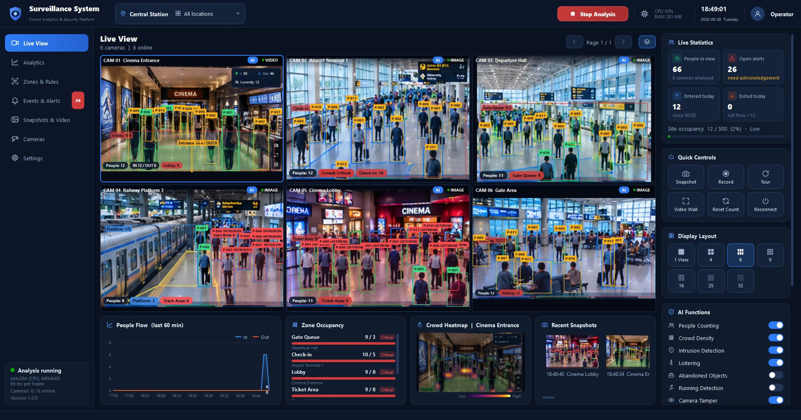
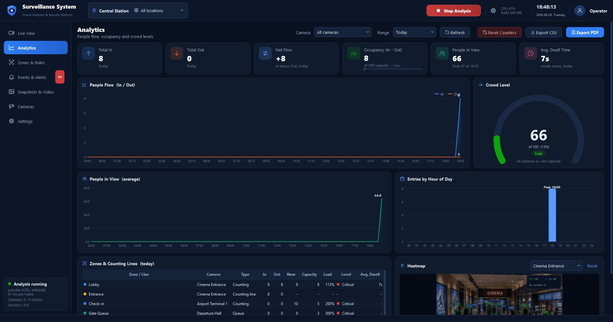
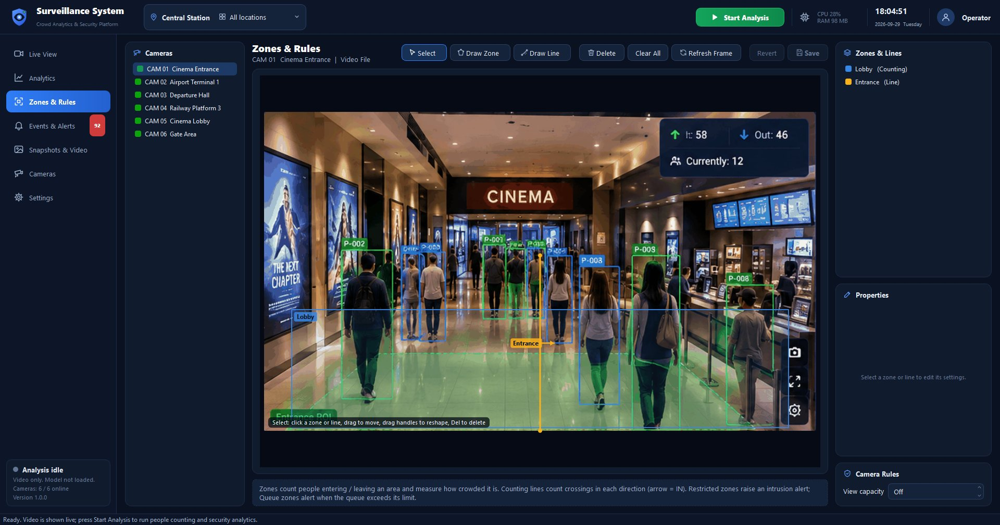

# Surveillance System — Crowd Analytics & Security

A Windows desktop application for monitoring public venues such as railway stations, subways, airports, cinemas, malls and stadiums. It shows up to **32 video channels** from IP cameras, USB cameras, video files or still images. When the operator presses **Start Analysis**, it counts people entering and leaving areas, measures how crowded each area is, and raises security alerts.

Built with **Qt 5.15.2 (msvc2019_64)**, **OpenCV 4.14** and **ONNX Runtime 1.30** for **Visual Studio 2019**. All three are taken from the `package` folder.



| Analytics | Zones & Rules |
|---|---|
|  |  |

*The screenshots were taken with test pictures cut from the design mockups; the boxes printed inside those pictures belong to the mockups. The detector shown is the bundled YOLO26n model on CPU.*

---

## Features

### Live monitoring
- Video grid of **1, 4, 6, 9, 16, 25 or 32** tiles, with paging when there are more cameras than tiles.
- Double-click a tile for single view. **Camera Tour** cycles through the cameras.
- **Video wall** mode (F11) hides all chrome for full-screen monitoring.
- Sources:
  - **IP cameras** (RTSP / HTTP-MJPEG / RTMP, optional credentials, auto-reconnect).
  - **USB cameras** (with device detection and a resolution choice).
  - **Video files** (looping).
  - **Still images**.
- **Drag and drop** video or image files onto an empty tile to add them.
- Each tile shows camera status (LIVE / VIDEO / IMAGE / OFFLINE / RECONNECTING), plus AI and REC badges, flashing alert banners and chips for people and zone counts.
- Filter the grid by **location** (camera groups such as "Platform 1" or "Cinema Lobby").

### Analysis (runs only after **Start Analysis**)
- **People detection** with a YOLO ONNX model on CPU or NVIDIA CUDA. The built-in OpenCV HOG detector is used if no model is present.
- **Multi-object tracking** with person IDs and movement trails.
- **People counting**:
  - Polygon **zones** count entries, exits, current occupancy and dwell time.
  - Directional **counting lines** count IN and OUT crossings.
- **Crowd density**: zone occupancy against capacity, with levels **Low / Moderate / High / Critical**. People per m² is shown when the zone area is set. A whole-view capacity can be set for each camera.
- **Heatmap** of where people walk and stay (overlay on the video and in Analytics).

### Security rules and alerts

| Alert | Trigger |
|---|---|
| High density / Overcrowding | Zone or view reaches the warning / critical % of capacity |
| Queue building | Queue zone exceeds its queue limit |
| Intrusion | A person enters a **Restricted** zone |
| Loitering | A person stays in a zone longer than its loitering time |
| Wrong way | A person crosses a one-way line against the arrow |
| Running | A person moves faster than N body-heights per second (possible panic or pursuit) |
| Abandoned object | A bag or suitcase stays stationary and unattended (needs a COCO model) |
| Camera tamper | The lens is covered, blinded, blocked or out of focus |
| Camera offline / restored | The video signal is lost or comes back |

Every alert:
- is stored in SQLite;
- saves an **annotated snapshot** (optional);
- can start a **recording clip** automatically;
- flashes the camera tile, can beep, and shows a Windows tray notification.

Events can be filtered, searched, acknowledged and exported to CSV.

### Analytics panel
- KPIs: **Total In**, **Total Out**, **Net Flow**, **Occupancy (In − Out)** against site capacity, **People in View** with the peak time, and **Average Dwell Time**.
- Charts: **People Flow** (In/Out over time), **Crowd Level** gauge, **People in View** trend, and **Entries by Hour of Day** with the peak hour highlighted.
- A **table of zones and lines** (in, out, current count, capacity, load %, level, dwell) and a per-camera **heatmap**.
- Ranges: last hour, today, last 24 hours, last 7 days. Filter by camera. Export to **CSV** or a **PDF report**.

### Evidence and administration
- Manual snapshots (F2) and recordings (MP4 or AVI) per camera. Browse, play or delete them on the **Snapshots & Video** page. A recording can be re-analysed by adding it as a source.
- **Privacy masking** pixelates people on screen; recordings keep the original.
- Retention cleanup of old events, history, snapshots and recordings.
- Single-instance guard, system tray mode and auto-start of analysis.

### Memory-saving design
When the app starts, it **only decodes and shows video**. The detection model is loaded when you press **Start Analysis** and released again on **Stop Analysis** (configurable). While analysis runs:
- each camera is analysed at a configurable rate (default 8 fps);
- a bounded thread pool limits how many cameras are analysed at the same time;
- frames are down-scaled in the capture thread to the size of their tile;
- cameras that are not visible skip display conversion.

---

## Requirements

- Windows 10/11 x64.
- **Visual Studio 2019** with the *Desktop development with C++* workload (MSVC v142).
- Latest **Microsoft Visual C++ 2015–2022 Redistributable (x64)**. ONNX Runtime 1.30 needs a newer `msvcp140.dll` than older VS2019 installs ship with. If the app exits with "entry point not found", install the current redistributable.
- Optional GPU inference: an NVIDIA GPU with **CUDA 12.x** and **cuDNN 9** on the PATH, and a build with `gpu` (see below).

## Build

### Option A: Visual Studio solution (recommended)

`SurveillanceSystem.sln` / `SurveillanceSystem.vcxproj` is a native VS2019 project (toolset v142, x64). It needs neither CMake nor the Qt VS Tools extension: Qt's `moc` and `rcc` run as custom build steps.

1. Run `setup_packages.bat` once. It extracts OpenCV and ONNX Runtime from `package\` into `third_party\`.
2. Open **`SurveillanceSystem.sln`** in Visual Studio 2019.
3. Choose **Release|x64** or **Debug|x64** and press **F5**.

After each build, the post-build step runs `windeployqt` and copies the OpenCV, FFmpeg and ONNX Runtime DLLs and the `models` folder into `bin\<Configuration>\`, so the program runs from there. Intermediate files go to `obj\`.

Command-line build (finds VS2019's MSBuild with `vswhere`):

```bat
build_sln.bat              :: Release -> bin\Release\SurveillanceSystem.exe
build_sln.bat debug        :: Debug   -> bin\Debug\SurveillanceSystem.exe
build_sln.bat gpu          :: Release linked to the CUDA 12 build of ONNX Runtime
```

In Visual Studio, CUDA can be enabled by setting the `SSUseCuda` property to `true` in the `.vcxproj`.

**Adding a new Qt class with `Q_OBJECT`:**
1. In `SurveillanceSystem.vcxproj`, copy one of the `<CustomBuild Include="src\...h">` moc entries for the new header.
2. Add a matching `<ClCompile Include="$(GenDir)moc_<Name>.cpp" />` line.

Plain `.cpp`/`.h` files without `Q_OBJECT` are added the normal way in Visual Studio.

The solution also contains **EngineTests**, a console program that drives the real tracking, counting-line, zone and alert code with scripted people. It checks that:
- crossings are counted in the right direction;
- a person jittering on a line is never counted;
- zone entries and exits, occupancy, intrusion, loitering and overcrowding all behave correctly;
- zones are not double-counted in the site totals when the camera has a counting line;
- a person walking in front of another is counted once and IDs never swap, across 20 randomized runs with irregular analysis timing, box jitter and merged detections.

Run `bin\Release\EngineTests.exe`. Exit code 0 means every check passed.

**Without Visual Studio installed:** `build_sln.bat` and `build_vs2019.bat` fall back to a portable VS2019 C++ toolset (MSVC v142 14.29 + MSBuild 16.11) in `third_party\vs2019_buildtools`, if that folder exists. The project on this machine was built with it. Visual Studio 2019 itself uses its own installed toolset.

### Option B: CMake

```bat
build_vs2019.bat              :: generates build\SurveillanceSystem.sln (VS2019 generator)
build_vs2019.bat build        :: also compiles Release from the command line
build_vs2019.bat gpu          :: links the CUDA 12 build of ONNX Runtime
```

CMake cache options: `SS_QT_DIR`, `SS_OPENCV_DIR`, `SS_ORT_DIR`, `SS_USE_CUDA`. The output goes to `build\Release\` (or `build\Debug\`).

## Detection model

Two models are bundled in `models\` and deployed with every build:
- **YOLO26n** (`yolo26n.onnx`, the default): end-to-end, about 55 ms per frame on CPU.
- **YOLO11n** (`yolo11n.onnx`): about 63 ms per frame, and finds slightly more small, distant people.

Switch between them in **Settings → Detection Model**, which lists every `.onnx` file in `models\`. The side panel shows the active model and its measured time per frame while analysis runs. Without any model, the app falls back to OpenCV's HOG people detector, which is much less accurate.

See [models/README.md](models/README.md) for the test results, supported formats, export commands and **licence notes**. The bundled Ultralytics models are AGPL-3.0.

**Deployment note:** `onnxruntime.dll` (1.30) must be next to `SurveillanceSystem.exe`, and the build copies it there. Windows 11 ships an older `onnxruntime.dll` (1.17) in `System32`. If that one gets loaded instead, the app still starts, but reports the version problem and uses the HOG detector.

**How counting stays accurate:**
- **Hysteresis on counting lines:** a person must be clearly on one side, then clearly on the other, so someone standing on a line is never counted.
- **Appearance check in the tracker:** a colour signature of each person's clothing keeps IDs from swapping when people pass each other, even at low analysis rates.
- **No double counting:** if a camera has a counting line, its zones are left out of the site In/Out totals. The zones still report their own counts and occupancy.

## User accounts

The app always starts with a **sign-in window**. On the very first start, it asks you to create the **administrator** account.

| Role | Can do |
|---|---|
| **Viewer** | Watch live video, Analytics, Events and Snapshots (read only) |
| **Operator** | + start/stop analysis, acknowledge alerts, take snapshots and recordings, reset counters, switch AI functions |
| **Administrator** | + Cameras, Zones & Rules, Settings, deleting evidence, and the **Users** page |

- **Sign up:** anyone can request an account on the sign-in window's *Sign up* tab. New accounts start as *Viewer* with status *Pending approval* and can't sign in until an administrator approves them. The **Users** menu item shows a red badge with the number of waiting accounts.
- **Users page (administrators):** add users, approve sign-ups, change name or role, reset passwords (optionally forcing a change at the next sign-in), disable or enable, unlock and delete accounts.
- **Safety rules:**
  - The last active administrator can't be deleted, disabled or demoted.
  - Administrators can't change their own role or status.
  - 5 wrong passwords lock an account for 5 minutes.
- **Passwords:** at least 8 characters, with letters and digits. They are stored only as salted PBKDF2-HMAC-SHA256 hashes (120,000 iterations) in `surveillance.db`, never in readable form.
- **User menu** (your name, top right): *Change password*, *Manage users* and *Sign out*. Signing out locks the screen, but cameras, analysis and recording keep running, so a shift change never interrupts monitoring. Exiting the app asks for confirmation.
- **Audit trail:** these are all recorded as *User Account* events in **Events & Alerts**:
  - sign-ins, sign-outs and exits;
  - failed attempts (warning) and lock-outs (critical);
  - sign-up requests;
  - every administrator action on users.

## Quick start

1. **Cameras** → **Add Camera**. Choose IP Camera / USB Camera / Video File / Image. Use **Test Connection**, then save. You can also drop video files onto the Live View grid.
2. **Zones & Rules** → pick a camera → **Draw Zone** (click the corners, double-click to finish) or **Draw Line** (click the start and end; the arrow marks the IN side). Set the type (Counting / Restricted / Queue), capacity, area, loitering time and one-way option → **Save**.
3. Press **Start Analysis** in the top bar (F5).
4. Watch **Live View**, check **Analytics**, and acknowledge alerts in **Events & Alerts**.

## Keyboard shortcuts

| Key | Action |
|---|---|
| F5 | Start / stop analysis |
| F11 / Esc | Enter / leave video wall |
| F2 | Snapshot of the selected camera |
| Ctrl+1 … Ctrl+8 | Switch pages (pages your role can't open are skipped) |
| Del / Esc / Enter | Zone editor: delete / cancel / finish polygon |

## Command-line options (for testing)

| Option | Effect |
|---|---|
| `--page <0-7>` | Open a page on start (0 Live View … 6 Settings, 7 Users) |
| `--screenshot <file.png> [--delay <ms>]` | Save a picture after the delay (default 6000 ms), then quit. On its own, it captures the sign-in window |
| `--user <name> --password <pw>` | Sign in without the dialog. **Only accepted together with `--screenshot`**, for automated tests |

Example: `SurveillanceSystem.exe --page 1 --screenshot analytics.png --delay 20000 --user admin --password ...`

## Data locations

Everything is stored in `<exe folder>\data\`. If that folder is not writable, `%APPDATA%\SurveillanceSystem\` is used instead.

- `settings.ini` — settings
- `cameras.json` — cameras, zones and lines. IP camera credentials are stored in the URL in plain text, so protect this folder.
- `surveillance.db` — SQLite database with events, per-minute people-flow history and user accounts (hashed passwords). Deleting it removes all accounts; the next start asks for a new administrator.
- `snapshots\yyyy-MM-dd\`, `recordings\yyyy-MM-dd\` — evidence files (folders are configurable)

## Performance tips for 32 channels

- Use camera **sub-streams** (e.g. 640×360) for IP cameras. Decoding thirty-two 1080p streams is expensive.
- Lower **Settings → Analysis rate** (e.g. 3–5 fps) and use a nano model. Set **Parallel cameras** to about the number of physical CPU cores divided by **Threads / inference**.
- Use the CUDA build with an NVIDIA GPU for large deployments.
- Exclude cameras that only need recording from analysis (tile right-click menu, or camera properties).

## Project layout

```
src/
  core/   Types, Settings, Detector (ONNX/HOG), Tracker, AnalysisEngine (counting + rules),
          CameraWorker (capture thread), CameraManager, AnalyticsStore, Database, EventManager,
          Overlay (shared drawing), SystemMonitor
  ui/     MainWindow, Theme (colours, icons, QSS)
    widgets/  VideoTile, CameraGrid, Charts, ZoneEditor, Common (cards, KPI tiles, switches)
    pages/    LiveView, Analytics, Zones, Events, Media, Cameras (+ dialog), Settings
resources/  dark.qss stylesheet, icons, app.ico, version info
models/     put the ONNX detector here
package/    Qt, OpenCV, ONNX Runtime and CMake packages (inputs)
third_party/ extracted packages (created by setup_packages.bat)
tests/      EngineTests: counting/tracking scenarios (counting_test.cpp) and user accounts (user_test.cpp)
docs/       screenshots
SurveillanceSystem.sln / .vcxproj   native VS2019 project (bin\, obj\ are its outputs)
CMakeLists.txt, build_vs2019.bat    alternative CMake route (build\ is its output)
```
